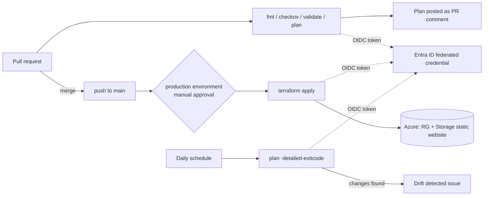

# terraform-azure-gha

[](https://github.com/Disassemblern/terraform-azure-gha/actions/workflows/terraform.yml)

Terraform deploys a static website to Azure Storage. GitHub Actions runs it, using OIDC to authenticate so the repo stores no cloud credentials.

**Live:** https://stsite58c3220a.z1.web.core.windows.net/

## How it works



- **No secrets in CI:** GitHub issues a short-lived OIDC token, and Entra ID exchanges it for an Azure access token. The federated credentials trust only this repo's `pull_request` events, its `production` environment and its `main` branch (used by the drift check). They are pinned to the repo's numeric owner and repo IDs, so a re-created repo with the same name gets no access.
- **Remote state:** an Azure Storage backend with blob versioning and lease-based locking.
- **Security scan:** Checkov scans `infra/` on every PR. A failing check blocks the merge. Each skipped check has its reason written next to it in [main.tf](infra/main.tf).
- **Gated applies:** every push to `main` that changes `infra/` or the workflow waits for approval in the `production` environment.
- **Drift detection:** a daily plan opens a `Drift detected` issue when Azure no longer matches the code, and closes the issue once they match again.
- **Teardown:** run the workflow manually with `destroy` checked.
- **Cost:** about $0. It uses one LRS storage account for the site and one for state.

## Layout

```
bootstrap/bootstrap.sh       one-time setup: state storage, OIDC identity, GitHub secrets
infra/                       Terraform: resource group, storage account, static website, index.html
.github/workflows/terraform.yml   PR plan + gated apply
.github/workflows/drift.yml       daily drift check
```

## Reproduce

Requires the Azure CLI, the GitHub CLI and Terraform 1.17.

```sh
az login
gh auth login
./bootstrap/bootstrap.sh     # prints the local init command at the end
```

Then open a PR. The plan is posted as a comment on it. Merge the PR and approve the deployment to apply. The website URL appears in the job summary.

Local run:

```sh
terraform -chdir=infra init -backend-config=storage_account_name=<printed by bootstrap>
terraform -chdir=infra plan
```
